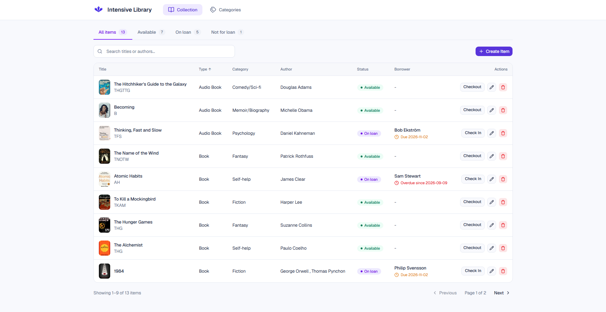

# Intensive Library

A library management app where staff can manage books and other items, organise them into categories, and track who has borrowed what.

**🔗 Live demo:** [Intensive Library](https://intensive-library-4rod.onrender.com/)

## What it does

- Add, edit and delete library items, with cover image upload
- Lend items to borrowers and check them back in
- See each item's status: *Available*, *On loan* or *Not for loan*
- Search, filter by status, sort by any column, and page through results
- Manage categories and see how many items each one has

## Built with

React · TypeScript · Vite · Tailwind CSS · shadcn/ui · TanStack Query · React Hook Form · Zod · React Router · Axios · Cloudinary

## Technical highlights

- **Server state with TanStack Query** – data is cached and refreshed automatically after changes, with loading skeletons while it loads.
- **Type-safe forms** – React Hook Form with Zod validation, sharing TypeScript types with the API layer.
- **Clean structure** – API calls in `services/`, data logic in custom hooks, UI in small reusable components.
- **Separated logic and display** – an item's status is worked out once, then mapped separately to its label and colour, so text and styling can change without breaking the logic.
- **Responsive layout** – collapsible sidebar that works on mobile.

## What I learned

- **Building a UI with shadcn/ui** – I learned how to use and customise shadcn components such as the table, dialogs and sidebar, instead of building everything from scratch. This let me spend more time on the features themselves.
- **Loading states** – I used skeleton rows that match the shape of the real table, so the page feels faster and doesn't jump around while data loads.
- **Image uploads** – I learned how to upload an image from the browser straight to Cloudinary, get back the image URL, save it with the library item, and show the cover in the table.

## About me

Moustafa Akl – Junior Software Developer that tries my best to better my skills and always am down to learn new things 
